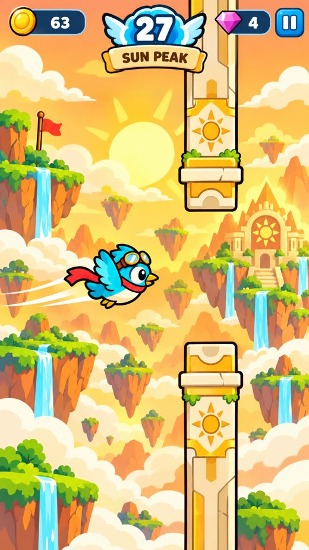
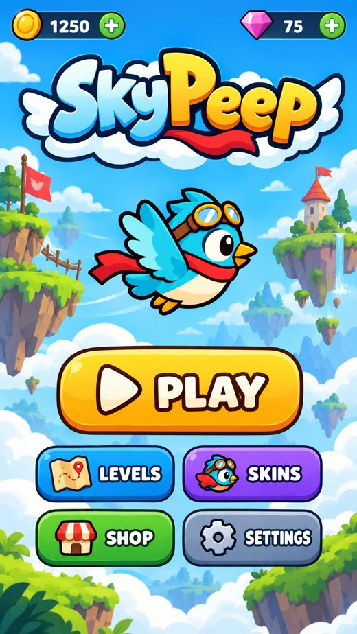
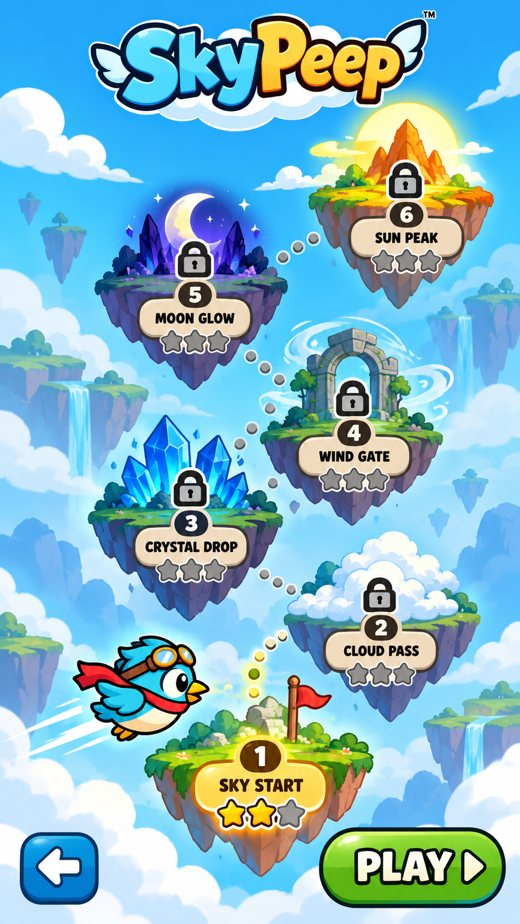
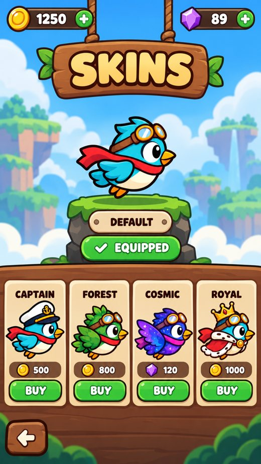

# 🐦 SkyPeep

**Six fantastic sky worlds. One brave little aviator. Your next flight starts here.**

A vivid 2D Android arcade adventure with floating islands, enchanted ruins, glowing crystals and a blue bird with a red scarf.

## Explore the sky

| Home | Six worlds | Your bird |
|:---:|:---:|:---:|
|  |  |  |

Fly through **Sky Start**, **Cloud Pass**, **Crystal Drop**, **Wind Gate**, **Moon Glow** and **Sun Peak**. Each world features distinct, original 2D scenery and obstacle styling.

### What is inside

- 🎮 Responsive touch-to-flap flight and score progression
- 🗺️ Six themed levels with stars and unlocks
- 🐦 Three-frame character flight animation
- ✨ Collectible coins, gems and alternate bird skins
- 🏆 Personal bests and locally saved progress
- 🔊 Music, sound effects and pause/resume
- 📤 Share your score through Android

## Android builds

Download the newest **preview** release from [GitHub Releases](https://github.com/bren-wp/Flappy-Bird/releases). Debug APKs are installable for testing; bundled AABs are intentionally **unsigned** until release signing is configured. The app's final testing and store readiness have not been certified.

## Credits

SkyPeep illustrations were created for this project using the user-provided design references. Android implementation uses Kotlin and [libGDX](https://libgdx.com/). See [LICENSE](LICENSE) for repository licensing.